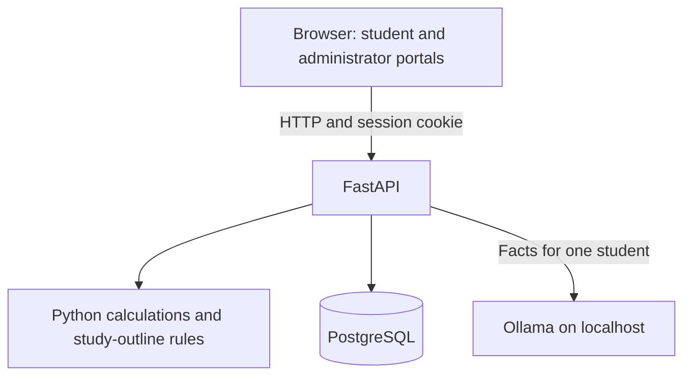

# AI-Powered Student Management System with Personalized Academic Support

A local college portal for Computer Science Semester 1. Administrators keep student records, assessments, attendance, and concerns. Students see their own results and can ask a local language model to explain them. Official marks and grades are calculated in Python. The model does not replace those calculations.

## Project overview

The application combines student administration with academic performance tracking and AI-assisted learning support. FastAPI serves the administrator and student portals, stores records in PostgreSQL, and sends a limited set of stored facts to a local Ollama model when someone asks for an explanation.

The pages are HTML, CSS, and vanilla JavaScript. There is no separate frontend build and no hosted LLM API key.

## Key features

- Student registration and sign-in, with a separate administrator sign-in page.
- Role-based sessions. A student can read and change only that student's own records.
- Administrator and student portals.
- Subject management for the shared Computer Science, Semester 1 structure. Administrators can add, edit, activate, and deactivate subjects. A subject that still has academic records cannot be deleted.
- Internal assessments: CAT 1 with Assignment 1, CAT 2 with Assignment 2, and CAT 3 with Assignment 3.
- External examination marks, stored as a raw score out of 100.
- Final subject results and grades calculated from the displayed internal and external marks.
- Attendance recording and the student's own attendance summary.
- Student concerns, including a backend check that a new concern uses an active subject.
- Subject-based learning resources and video links stored in the database.
- Study plans that a student can generate, edit, and save. Opening the page does not overwrite a saved plan.
- Revision suggestions based on stored results and reported difficulties.
- Ask AI, an explanation of the academic report, and an explanation of the study plan.
- Administrator drafting assistance for a reply to a student concern. The draft is guidance. The administrator still saves the reply.

The active examination types are FAT (Formative Assessment Test), Assignment, and End Semester Examination. FAT and Assignment name the formative and assignment work whose scores stay in the internal assessment. End Semester Examination is the external raw mark. Those scores are not stored a second time on the examination row.

## Academic structure

Every student is assigned to Computer Science, Semester 1.

The five default active subjects are:

1. Data Structures and Algorithms (DSA)
2. Database Management Systems (DBMS)
3. Data Science (DS)
4. Artificial Intelligence and Machine Learning (AIML)
5. Computer Networks (CN)

Administrators can add other subjects. A new concern, attendance row, resource, or assessment must use a subject that is active at the time. Inactive subjects can remain on historical records.

### Assessment rules

CAT, assignment, and external raw scores are stored as whole numbers. Calculated marks are not stored. They are produced when a result is read.

- Each pair score is `(CAT × 0.70) + (Assignment × 0.30)`, kept exact.
- The internal mark out of 50 is the mean of the three pair scores, rounded half up to one decimal place.
- The internal mark is incomplete when any of the six CAT or assignment scores is missing.
- The external mark out of 50 is the raw mark out of 100 multiplied by `0.50`, then rounded half up to one decimal place. A raw score of 80 becomes 40.0.
- The final mark out of 100 is the displayed internal mark plus the displayed external mark. It is capped at 100.0.
- A missing internal mark or a missing external mark leaves the final mark and grade incomplete. A missing score is not treated as zero.

Grades use that final mark, with no extra rounding to a whole number:

| Final mark | Grade | Result |
|---|---|---|
| Below 50 | F | Fail |
| 50 up to, but not including, 60 | B | Pass |
| 60 up to, but not including, 70 | B+ | Pass |
| 70 up to, but not including, 80 | A | Pass |
| 80 up to, but not including, 90 | A+ | Pass |
| 90 through 100 | O | Pass |
| Internal or external mark missing | No grade | Incomplete |

The application does not calculate GPA or CGPA.

An older percentage-style mark table still exists for historical examination rows. It is not the official Semester 1 grade. The student My Results page shows the internal, external, and final subject tables.

## AI architecture

Ollama runs on the same computer and is not bundled with this repository. FastAPI calls it over HTTP. The model name and address come from the environment. `.env.example` sets `OLLAMA_MODEL` to `qwen3:8b` and `OLLAMA_BASE_URL` to `http://localhost:11434`. If `OLLAMA_MODEL` is left unset, the code falls back to `qwen2.5:3b`.

Three kinds of work stay separate:

- **Official calculations and business rules** live in Python, mainly `app/academics.py`, `app/calculations.py`, and `app/guidance.py`. Pass, fail, incomplete, grades, and the rule-based study outline come from stored scores and reported concerns.
- **LLM text** is used for Ask AI, academic-report explanations, revision suggestions, study-plan explanations, and administrator concern-reply drafts. The model receives a fact sheet for one student. Its reply is not saved as an official result.
- **Records** live in PostgreSQL: students, assessments, attendance, concerns, resources, and saved study plans.

If Ollama is stopped or the configured model is not installed, the rest of the portal still works. Assistant routes report that the model is unavailable.

## Technology stack

Verified from `requirements.txt` and the application source:

- Python 3.11
- FastAPI 0.162.0 and Uvicorn 0.54.0
- SQLAlchemy 2.1.6
- PostgreSQL through psycopg 3.3.6
- Pydantic, used by the FastAPI request and response models
- bcrypt 5.0.0 for password hashes
- python-dotenv 1.2.4 for `.env`
- pytest 9.1.1 and httpx 0.28.1 for tests
- HTML, CSS, and vanilla JavaScript in `static/`
- Ollama, installed separately, for local model calls

## Architecture



## Project structure

| Path | Purpose |
|---|---|
| `app/main.py` | Application, page routes, subjects, examinations, and assessment routes |
| `app/portal_routes.py` | Registration, login, student portal, concerns, attendance, and demo loading |
| `app/models.py` | SQLAlchemy tables |
| `app/schemas.py` | Request and response validation |
| `app/migrate.py` | Startup schema updates. Existing rows are not dropped |
| `app/seed.py` | Idempotent fictional demo data. Startup does not call it |
| `app/academics.py` | Semester 1 internal, external, final, and grade calculations |
| `app/calculations.py` | Older percentage results and attendance percentages |
| `app/guidance.py` | Rule-based resource selection and study outline |
| `app/assistant.py` | Prompts and the Ollama client |
| `app/records.py` | Loads one student's facts and filters them to active subjects |
| `app/security.py` | Password hashes and session tokens |
| `app/bootstrap.py` | Creates the first administrator once |
| `static/` | Landing page, login, registration, and both portals |
| `tests/` | Automated tests |
| `.env.example` | Placeholder configuration. Copy it to `.env` locally |

There is no Alembic directory. Schema changes are applied by `app/migrate.py` when the application starts.

## Installation and setup

These steps use Windows PowerShell. Python 3.11 is the version this project was built with. PostgreSQL must already be installed. The application does not create the database user and does not create the empty database for you.

The example connection uses port `5433`, which is PostgreSQL 18 on the machine where this project was developed. PostgreSQL 17 often uses port `5432`. Use the host, port, user, and database that exist on your computer. Keep the real password in `.env` only.

```powershell
git clone https://github.com/karthik2104-cr/AI-Powered-Student-Management-System.git
cd AI-Powered-Student-Management-System
py -3.11 -m venv .venv
.\.venv\Scripts\Activate.ps1
python -m pip install -r requirements.txt
Copy-Item .env.example .env
```

Edit `.env` and replace `your_password_here` with the PostgreSQL password for your local user. Leave `ADMIN_EMAIL` and `ADMIN_PASSWORD` blank to let the first startup create `admin@studentmanagement.local` and write the generated password to `.admin-credentials`. That file is gitignored. You can instead set both values before the first startup. Restarting does not reset an existing administrator password.

Create the empty database once, with your own PostgreSQL tools:

```sql
CREATE DATABASE student_management;
```

Install Ollama separately when you want live explanations, then pull the model named in `.env`:

```powershell
ollama pull qwen3:8b
```

Starting the application creates missing tables and the first administrator. It does not load demo students. After signing in as an administrator, use **Load demo data** on the dashboard. That action is idempotent. Demo sign-in passwords are written to `.demo-credentials` on this computer and are not part of the repository.

## Running the application

```powershell
.\.venv\Scripts\python.exe -m uvicorn app.main:app --host 127.0.0.1 --port 8000
```

- Welcome page: http://127.0.0.1:8000/
- Student login: http://127.0.0.1:8000/login
- Student registration: http://127.0.0.1:8000/register
- Student dashboard: http://127.0.0.1:8000/student/dashboard
- Administrator login: http://127.0.0.1:8000/admin/login
- Administrator dashboard: http://127.0.0.1:8000/admin/dashboard
- http://127.0.0.1:8000/app redirects to the welcome page
- API documentation: http://127.0.0.1:8000/docs
- Health check: http://127.0.0.1:8000/health

`GET /health` reports whether the process is running and whether PostgreSQL answered `SELECT 1`. `GET /assistant/status` reports whether Ollama is reachable and whether the configured model is installed.

## Testing

From the project directory, with the virtual environment's Python:

```powershell
.\.venv\Scripts\python.exe -m pytest -ra
```

Calculation tests check the mark and grade rules. Portal and API tests need a configured PostgreSQL database. They create temporary rows, read them back, and delete those rows. They are not a substitute for a backup, and they should not be pointed at a database you cannot afford to modify. One health test is skipped when PostgreSQL is already configured, because that test checks the missing-database message. A live model test runs only when the configured Ollama model is installed.

## Security and limitations

This is a local development and demonstration project. It has not been reviewed as a production system.

- Passwords are stored as bcrypt hashes. Session cookies hold a random token, and the database stores a hash of that token.
- Do not commit `.env`, `.admin-credentials`, or `.demo-credentials`.
- Do not reuse demo passwords, the generated administrator password, or the test-only account in `tests/support.py` outside this project.
- Do not load real student records into a public demo database or commit a database dump.
- The model can be wrong. Official marks stay with the Python calculations.
- The public pages are intended for `127.0.0.1`. They are not a hardened internet deployment.

## Screenshots

No screenshots are stored in this repository. Add images later only if you have them, and keep real student data out of the pictures.

## License

No license has been selected yet. Ask the project owner before adding one.
